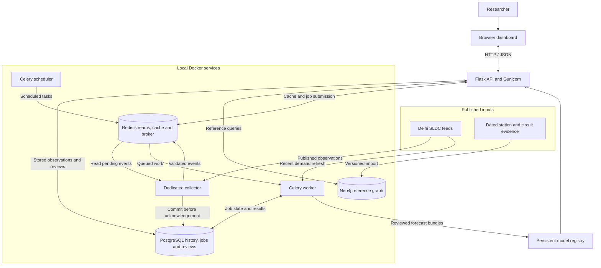
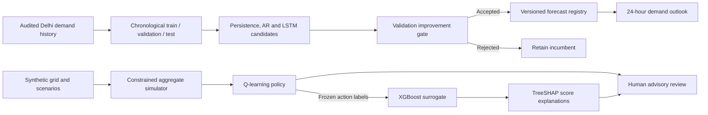

# PRISM

### Power Grid Resilience through Intelligent Smart Management

**A research platform for understanding Delhi's electricity network, forecasting
its demand, and investigating hypothetical disruptions.**


[Quick start](#quick-start) · [Architecture](#architecture) · [Phase updates](#phase-updates) ·
[Results and limitations](#results-and-limitations) · [Team](CONTRIBUTIONS.md)

## What the project does

Electricity readings, station inventories, historical demand and research models
answer different questions. PRISM brings them into one workspace while retaining
the source, timestamp and limitations of each result.

A researcher can locate a station, inspect its published readings, examine the
next 24 forecast hours, remove an asset in a hypothetical connectivity scenario,
and review a synthetic dispatch recommendation with an explanation. The platform
supports analysis and human review; it does not operate physical grid equipment.

| Question | PRISM workflow |
|---|---|
| What has the source published? | View Delhi demand, frequency, drawal and scheduled power with freshness indicators; inspect mapped station measurements. |
| Which assets are connected in the evidence? | Search 66 reference assets and 261 connection records; inspect provenance and geographic locations. |
| What demand does the model project? | Compare persistence, autoregressive and LSTM forecasts over 24 hours, with origin timestamps and available empirical intervals. |
| What happens if an asset becomes unavailable? | Inject hypothetical asset/connection outages and inspect backend-computed connectivity changes, isolated assets and step logs. |
| Why did a policy suggest an action? | Compare the frozen Q-policy with its XGBoost surrogate, inspect TreeSHAP factors, and record an advisory accept/override decision. |
| What could explain supplied alarms? | Investigate timestamped alarms using graph paths and timing hypotheses, with explicit causal limitations. |

Published Delhi evidence, real-demand forecasting and synthetic policy experiments
remain distinguishable throughout the application. See the [dashboard guide](docs/dashboard.md)
for controls and a demonstration sequence.

## Technology stack

| Layer | Technologies and purpose |
|---|---|
| Interface | Jinja templates, HTML/CSS, native JavaScript and SVG; Leaflet with OpenStreetMap tiles for geographic inspection. No npm frontend build. |
| Application | Python, Flask REST endpoints and Gunicorn; request validation, provenance and operator-token-protected review actions. |
| Data processing | pandas and NumPy for validation, gap-aware hourly aggregation and chronological evaluation. |
| Graphs | NetworkX for connectivity and investigation; Neo4j for immutable, source-qualified reference datasets. |
| Storage and execution | PostgreSQL for observations/jobs/reviews; Redis for streams, caching and the Celery broker; Celery worker/beat for recoverable jobs and schedules. |
| Models | NumPy autoregression/LSTM and tabular Q-learning; XGBoost imitates the frozen policy, while SHAP explains the surrogate's scores. |
| Deployment | Docker Compose runs web, worker, scheduler, collector, PostgreSQL, Redis and Neo4j as one local stack. |

Dependencies and constraints are recorded in [pyproject.toml](pyproject.toml) and
[requirements-phase3-tested.txt](requirements-phase3-tested.txt). Component licences
remain distinct; see [deployment notes](INSTRUCTIONS.md#dependencies-and-source-access).

## Architecture

### Application and data services



The web service reads stored observations; the dedicated collector polls the
published aggregate/station feeds. The worker separately refreshes demand history
and runs queued research jobs. Service readiness and upstream data freshness are
reported separately. The only PRISM web endpoint is **localhost:5050**.

### Forecasting and policy research



Test results measure candidate performance; they do not select promotion. Policy
experiments use a separate synthetic simulator because the reference inventory
lacks the electrical parameters needed for real-network dispatch training.
Detailed contracts are in [architecture](docs/architecture.md),
[methodology](docs/METHODOLOGY.md) and [OpenAPI](docs/openapi.json).

## Phase updates

### Phase 1 — Foundation

Established the data, graph and application contracts:

- Validated a synthetic 12-node, 12-edge network with 700 MW aggregate supply/demand.
- Generated 336 hourly measurements with preprocessing and quality checks.
- Added deterministic baseline advice, NetworkX modelling and optional Neo4j import.
- Built the Flask API and dashboard with asset inspection and measurement charts.

**Checkpoint:** 19 automated tests passed for the declared prototype.

### Phase 2 — Simulation and learning

Added reproducible forecasting and policy experiments:

- Expanded the synthetic fixture to 2,160 hourly observations.
- Implemented 15-minute simulation with generator/battery constraints and scheduled outages.
- Defined normal, renewable-ramp, plant-fault, line-fault and concurrent-fault scenarios.
- Evaluated persistence, autoregression and a compact NumPy LSTM chronologically.
- Trained masked six-action Q-learning across five seeds and compared it with the rule baseline.
- Integrated forecast, policy and scenario controls and results into the dashboard.

**Checkpoint:** 42 tests passed. LSTM did not outperform autoregression; Q-learning
showed mixed results rather than general operating improvement. Those findings remain
in the [forecast](reports/phase2_forecasting.json) and [dispatch](reports/phase2_dispatch.json) reports.

### Phase 3 — Integration and refinement

Connected source-qualified Delhi evidence to a durable research application:

- Reconciled 66 reference assets, 245 dated circuit observations and 16 interface assertions.
- Mapped 49 station readings; placed 49 assets at sourced geographic locations.
  The two coverage sets are distinct; 17 unlocated assets remain in the directory.
- Added Redis/PostgreSQL ingestion with validation, deduplication, recovery and provenance.
- Audited the requested two-year demand range and implemented real 24-hour forecasts.
- Added the six-action XGBoost surrogate, actual TreeSHAP and supplied-alarm investigation.
- Implemented durable jobs/cancellation, saved reviews, hourly refresh and weekly/drift retraining.
- Packaged seven Docker services behind one web endpoint, with readiness checks and persistent data.
- Refined direct autoregression and the residual LSTM; promoted the validation-selected
  forecast bundle with rollback. Six new dispatch candidates failed their acceptance gate.
- Added source-cohort/voltage-layer evidence graphs and an electrical-data eligibility audit.
- Rechecked 190 incomplete demand days; no additional eligible hours were recovered.

**Checkpoint:** all 15 implementation milestones delivered; 126 tests passed in the
latest recorded run. Full research acceptance is still partial. Background-job
panels are temporarily hidden; their backend mechanisms remain available.

### Phase 4 — Evaluation, deferred

The next evaluation stage covers physical fault/frequency/cascade validation,
qualified operator studies, long-term availability and backup/restore exercises.
These have not been completed. Missing electrical inputs, historical coverage and
dispatch improvement remain open dependencies rather than completed milestones.

The [phase register](docs/PHASES.md) retains requirement IDs, acceptance targets,
evidence links and outstanding work. [CONTRIBUTIONS.md](CONTRIBUTIONS.md) assigns
each team member's scope and review responsibilities across the phases.

## Results and limitations

Historical demand results use the same 46 daily test origins and 24-hour horizons:

| Model | Original RMSE | Refined RMSE |
|---|---:|---:|
| Autoregressive | 426.54 MW | **389.21 MW** |
| LSTM | 758.40 MW | **498.46 MW** |

The refined models meet the scoped peak-normalized MAE/RMSE targets. These are
retrospective comparisons, not prospective validation. MAPE remains above 5%;
nominal 90% intervals covered 77.36% of test values. [Full forecast evidence](reports/phase3_forecast_refinement.json).

- **Data:** 555 hourly demand gaps remain; eligible real solar/wind history is unavailable.
- **Grid:** dated reference connections do not establish current switching states,
  verified terminal buses, impedance or operating limits. Map segments are endpoint
  relationships, not surveyed routes or measured flow; station loading is not plant output.
- **Simulation:** connectivity and synthetic aggregate models do not validate AC/DC
  power flow, electrical protection, frequency dynamics or physical switching.
- **Dispatch:** no improved real-grid operating benefit is established. New candidates
  were not promoted; surrogate fidelity is not dispatch optimality.
- **Investigation:** graph/timing hypotheses are not proven physical root causes.
  Saved reviews never issue equipment commands.

## Quick start

Install and start Docker with Compose, then run from the repository root:

```sh
cp .env.example .env
# Set NEO4J_PASSWORD, POSTGRES_PASSWORD and PRISM_OPERATOR_TOKEN in .env.
make up
```

Open **[http://127.0.0.1:5050](http://127.0.0.1:5050)**. Keep existing database
passwords when reusing volumes. For VS Code development, run `make dev` and open
[http://127.0.0.1:5051](http://127.0.0.1:5051). This starts Docker dependencies
and runs the local Python web server with `.env` loaded automatically.
Docker web stays on 5050; the local server uses 5051 to avoid a port conflict.

```sh
make status       # Service health and ports
make logs         # Web, worker and collector logs
make restart      # Rebuild web after frontend-only changes
make up           # Rebuild/start the complete stack after shared-code changes
make stop         # Stop, preserving data
make down         # Remove containers/network, preserving named volumes
```

Never use `down -v` for routine cleanup. [INSTRUCTIONS.md](INSTRUCTIONS.md) covers
credentials, ports, commands without Make and troubleshooting. Geographic tiles
and public-feed refreshes require internet access.

## Development and verification

For host-side tests, use Python 3.11+:

```sh
python3 -m venv .venv
. .venv/bin/activate
python -m pip install -r requirements-phase3-tested.txt
python -m pip install -e '.[phase3,neo4j]'
make test
```

Linux uses xgboost-cpu; macOS may need libomp. Docker remains the application entry
point. Latest recorded suite: **126 tests passed**; see [verification.md](docs/verification.md).
Read-only checks on port 5050: `/api/health`, `/api/readiness`, `/api/operations/health`.
Integration verifiers submit jobs and may write/retrain; run them deliberately.

## Repository guide

| Location | Purpose |
|---|---|
| `prism/` | Backend, models, graph logic, template and frontend assets |
| `data/` | Fixtures, reviewed inventories, manifests and local raw evidence |
| `models/`, `reports/` | Versioned model artifacts and measured evaluation evidence |
| `scripts/`, `tests/` | Acquisition, experiments, verification and tests |
| `docs/PHASES.md` | Detailed phase status, report traceability and acceptance targets |
| `docs/` | Technical guides, methodology, provenance and verification |
| `deliverables/` | [Editable demo deck](deliverables/PRISM_Phase3_Demo.pptx); use the phase register for current metrics |
| `artifacts/` | Ignored runtime context and model-registry history; preserve for reproducibility |

[DECISIONS.md](DECISIONS.md) records design choices. Generated working files are
excluded from Git; raw evidence, models and persistent volumes are not disposable caches.
